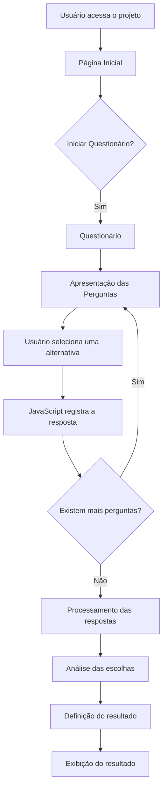
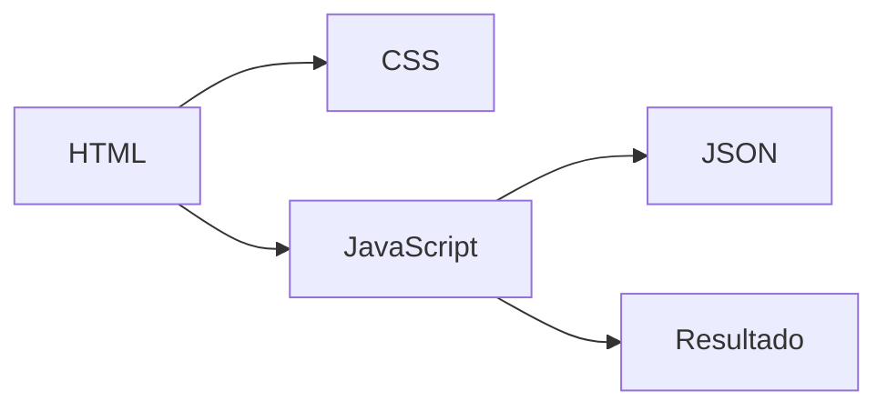

# Mundo SENAI — Sociologia

> Projeto desenvolvido para a disciplina de **Sociologia**, utilizando **HTML, CSS e JavaScript**, com o objetivo de relacionar as escolhas do usuário a diferentes modelos de produção.

---

## Sumário

- [Sobre o Projeto](#sobre-o-projeto)
- [Objetivo](#objetivo)
- [Funcionamento](#funcionamento)
- [Tecnologias](#tecnologias)
- [Estrutura do Projeto](#estrutura-do-projeto)
- [Divisão de Responsabilidades](#divisão-de-responsabilidades)
- [Fluxo do Sistema](#fluxo-do-sistema)
- [Questionário](#questionário)
- [Interface](#interface)
- [Como Executar](#como-executar)
- [Equipe](#equipe)
- [Acesso ao Projeto](#acesso-ao-projeto)

---

## Sobre o Projeto

O **Mundo SENAI — Sociologia** é um projeto web interativo desenvolvido para apresentar, de maneira simples e dinâmica, diferentes modelos de produção a partir das escolhas realizadas pelo usuário.

A aplicação possui uma página inicial responsável por apresentar a proposta do projeto e direcionar o usuário para um questionário.

Durante o questionário, o usuário responde a uma sequência de perguntas rápidas. Cada resposta possui uma relação com determinados modelos de produção e, ao final, o sistema analisa as escolhas realizadas para apresentar o resultado correspondente.

### Conceito

```text
Usuário
   │
   ▼
Página Inicial
   │
   ▼
Questionário
   │
   ▼
Respostas
   │
   ▼
Processamento
   │
   ▼
Análise das Escolhas
   │
   ▼
Resultado
```

---

## Objetivo

O principal objetivo do projeto é utilizar recursos de desenvolvimento web para criar uma experiência interativa relacionada aos conteúdos estudados em Sociologia.

A aplicação busca:

- apresentar conceitos relacionados aos modelos de produção;
- permitir que o usuário interaja com o conteúdo;
- coletar respostas através de um questionário;
- processar as escolhas realizadas;
- apresentar um resultado baseado nas respostas;
- utilizar tecnologias web de forma integrada.

---

## Funcionamento

O sistema foi planejado para seguir uma sequência simples de interação:

1. O usuário acessa a página inicial.
2. A página apresenta o projeto e sua proposta.
3. O usuário seleciona o botão para iniciar.
4. O sistema direciona para o questionário.
5. As perguntas são apresentadas ao usuário.
6. O usuário seleciona suas respostas.
7. O JavaScript registra e processa as escolhas.
8. O sistema realiza a análise das respostas.
9. O resultado é apresentado ao usuário.

---

## Tecnologias

| Tecnologia | Utilização |
|:---:|---|
| **HTML5** | Estrutura e organização das páginas |
| **CSS3** | Estilização, layout e identidade visual |
| **JavaScript** | Interatividade e lógica do questionário |
| **JSON** | Armazenamento das alternativas e informações utilizadas pelo sistema |

---

## Estrutura do Projeto

```text
Mundo-SENAI/
│
├── JSON/
│   └── alternativas.json
│
├── JS/
│   ├── questionário.js
│   └── script.js
│
├── CSS/
│   ├── questionario.css
│   └── style.css
│
├── Página/
│   └── questionario.html
│
├── index.html
│
└── README.md
```

### Organização

#### `index.html`

Página inicial do projeto.

Responsável pela apresentação do projeto e pelo acesso ao questionário.

#### `Página/questionario.html`

Página responsável pela aplicação do questionário.

Contém a estrutura necessária para apresentar as perguntas e receber as respostas do usuário.

#### `CSS/style.css`

Arquivo responsável pela estilização da página inicial.

#### `CSS/questionario.css`

Arquivo responsável pela estilização específica da página do questionário.

#### `JS/script.js`

Arquivo JavaScript relacionado às funcionalidades da página inicial.

#### `JS/questionário.js`

Arquivo responsável pela lógica principal do questionário, incluindo o processamento das respostas e geração do resultado.

#### `JSON/alternativas.json`

Arquivo utilizado para armazenar as alternativas e informações utilizadas pelo questionário.

---

## Divisão de Responsabilidades

O desenvolvimento do projeto foi dividido entre os integrantes da equipe.

| Integrante | Responsabilidade |
|:---:|---|
| **Nilo** | Planejamento da interface e experiência do usuário |
| **Antony** | Desenvolvimento da página inicial |
| **Lucas** | Desenvolvimento do questionário e sua lógica |

---

### Nilo — UX/UI

Responsável pelo planejamento da interface e pela experiência do usuário.

Principais responsabilidades:

- planejamento da organização visual;
- definição das interações;
- organização da navegação;
- experiência do usuário;
- planejamento da interface do questionário.

---

### Antony — Página Inicial

Responsável pelo desenvolvimento da página inicial.

A página deverá apresentar:

- título do projeto;
- descrição da proposta;
- elementos visuais;
- botão para iniciar o questionário.

O botão deverá direcionar o usuário para a página do questionário.

---

### Lucas — Questionário

Responsável pelo desenvolvimento do questionário e de sua lógica.

Principais responsabilidades:

- criação das perguntas;
- implementação das alternativas;
- interação utilizando JavaScript;
- registro das respostas;
- processamento das escolhas;
- análise dos resultados;
- apresentação do modelo de produção correspondente.

---

## Fluxo do Sistema

O funcionamento da aplicação pode ser representado através do seguinte fluxo:



---

## Questionário

O questionário é o principal elemento interativo da aplicação.

Cada pergunta apresenta alternativas para que o usuário escolha a opção que mais corresponde à sua opinião.

As respostas são processadas pelo JavaScript e utilizadas para determinar o resultado final.

### Estrutura conceitual

```text
Pergunta
    │
    ├── Alternativa A
    ├── Alternativa B
    ├── Alternativa C
    └── Alternativa D
            │
            ▼
      Registro da resposta
            │
            ▼
      Próxima pergunta
            │
            ▼
       Final do formulário
            │
            ▼
     Análise das respostas
            │
            ▼
          Resultado
```

---

## Interface

### Página Inicial

A página inicial será responsável por introduzir o projeto ao usuário.

<!-- INSIRA A IMAGEM DA PÁGINA INICIAL AQUI -->


> Substitua `./assets/preview-home.png` pelo caminho da imagem utilizada no repositório.

---

### Questionário

A página do questionário apresentará as perguntas e as alternativas disponíveis.

<!-- INSIRA A IMAGEM DO QUESTIONÁRIO AQUI -->


> Substitua `./assets/preview-questionario.png` pelo caminho da imagem utilizada no repositório.

---

### Resultado

Ao finalizar o questionário, o sistema apresentará o resultado obtido a partir das respostas selecionadas.

<!-- INSIRA A IMAGEM DO RESULTADO AQUI -->


> Substitua `./assets/preview-resultado.png` pelo caminho da imagem utilizada no repositório.

---

## Como Executar

### 1. Clonar o repositório

```bash
git clone URL_DO_REPOSITORIO
```

### 2. Acessar a pasta

```bash
cd Mundo-SENAI
```

### 3. Executar o projeto

Por utilizar HTML, CSS e JavaScript, o projeto pode ser executado abrindo o arquivo:

```text
index.html
```

Também é recomendado utilizar uma extensão como **Live Server** durante o desenvolvimento.

---

## Arquitetura Simplificada



A aplicação utiliza o HTML como base estrutural, o CSS para a apresentação visual, o JavaScript para controlar a lógica e o JSON para armazenar os dados utilizados pelo questionário.

---

## Identidade Visual


---

## Equipe

| Integrante | Área |
|:---:|:---:|
| **Nilo** | UX/UI |
| **Antony** | Página Inicial |
| **Lucas** | Questionário |

---

## Status do Projeto

```text
[████████████████████░░] 90%
```

**Em desenvolvimento**

O projeto está sendo desenvolvido e novas funcionalidades e melhorias poderão ser adicionadas durante o processo.

---

## Acesso ao Projeto

Para acessar a versão online do projeto:

### [Acessar o Mundo SENAI](COLE_AQUI_O_LINK_DO_SITE)

---

<p align="center">
  Desenvolvido para o projeto Mundo SENAI — Sociologia.
</p>
